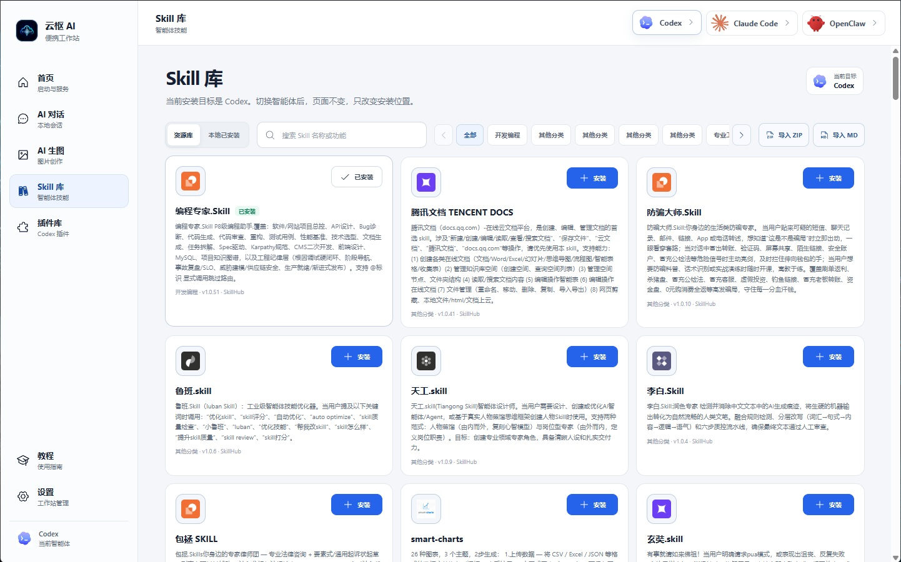

<div align="center">

# 云枢 AI 便携工作站 · 源码

**Windows 便携 AI 工作环境的启动器、运行后端与安装工具。**

Rust · Tauri 2 · React · TypeScript · AGPL-3.0-only

[**现成软件下载**](https://github.com/JJames646/codex-portable/releases/tag/v1.2.1) · [**工作站源码**](workstation) · [**安装器源码**](installer) · [**构建说明**](docs/BUILD_YUNSHU.md)


</div>

> **只想使用软件？** 前往 [下载仓库](https://github.com/JJames646/codex-portable)。现成软件需要卡密，加入 **QQ 群 `713993476`** 可免费申请。工作站卡密不包含模型 API 额度，模型服务需自行配置。

## 这份源码对应什么

本次公开的是现有 **v1.2.1 Windows 安装包**所对应的工作站源码，以及经历史构建记录核对的原生安装器源码。

| 内容 | 目录与对应关系 |
| --- | --- |
| 当前工作站前端及 Tauri 启动器 | [`workstation/launcher`](workstation/launcher) |
| 当前 Rust 运行后端 | [`workstation/backend-src`](workstation/backend-src) |
| 安装包内原始源码溯源记录 | [`workstation/SOURCE_PROVENANCE.json`](workstation/SOURCE_PROVENANCE.json) |
| 原生安装器、管理员打包工具及核心库 | [`installer`](installer) |
| 版本、文件哈希与发布核验 | [`docs/releases/v1.2.1.md`](docs/releases/v1.2.1.md) |
| 上游 Codex++ 和早期工作站代码 | 根目录 `apps/`、`crates/`、`assets/`，保留原历史 |

工作站源码从安装包内部的 `source/release-9303dc9771b80694/` 提取，**101 个源码及资源文件逐个哈希一致**；另 8 个 macOS `._` 元数据文件不进入公开源码。当前产品入口是 `workstation/`，不是根目录的旧 Codex++ 构建入口。安装器代码来自对应的 2026 年 9 月 20 日 r4 源码快照；其模板哈希与 v1.2.1 包内模板一致。

源码压缩包包含当前工作站与安装器；早期 Codex++ 工程和提交历史可在本 GitHub 仓库浏览。

## 产品能力

- 集中配置与启动 Codex、Claude Code、OpenClaw。
- AI 对话、独立图片生成入口和本地结果管理。
- Skills 与插件资源浏览、安装管理及目标引擎切换。
- 从程序所在位置推导工作目录，管理可迁移数据与子进程环境。
- 中文使用教程、工作站设置、卡密激活。
- 原生 Windows 安装向导、签名清单和文件完整性校验。

| 对话工作区 | Skills 管理 |
| --- | --- |
|  |  |

## 构建与验证

先阅读 [完整构建说明](docs/BUILD_YUNSHU.md)。前端验证：

```bash
cd workstation/launcher
npm ci
npm run check
npm test
npm run build
```

后端验证：

```bash
cargo test --manifest-path workstation/backend-src/Cargo.toml --locked
```

Windows 成品需要对应 Rust / MSVC 环境及 WebView2。此源码仓库不包含完整第三方运行时、开发者凭据、管理员签名私钥或生产服务器配置。

## 成品、源码与卡密

**成品软件：** 下载后安装，加入 QQ 群 **713993476** 免费申请工作站卡密；也可在闲鱼搜索 **“云枢 AI”** 咨询。

**源码：** 按 [AGPL-3.0-only](LICENSE) 及 [开源范围说明](docs/OPEN_SOURCE.md) 提供。原始源码快照保留历史包元数据，当前公开授权由本仓库许可证和范围说明明确。模型服务账号、API 额度、第三方程序和商标不属于本项目的源码授权。

## 视频与反馈

[](https://github.com/JJames646/codex-portable/releases/download/v1.2.1/Yunshu-AI-Workstation-Demo.mp4)

欢迎通过 [Issues](https://github.com/JJames646/codex-portable-workstation/issues) 反馈可复现的问题。提交说明中请注明源码版本、系统和复现步骤，不要附带 API Key、卡密或私人会话。

## 上游与致谢

本仓库保留 [BigPizzaV3/CodexPlusPlus](https://github.com/BigPizzaV3/CodexPlusPlus) 的 Fork 关系、提交历史和 AGPL 许可证。早期工作站基于该项目演进；当前源码新增内容在 `workstation/` 与 `installer/` 中单独展示。

[上游中文 README 归档](docs/upstream/CodexPlusPlus-README.zh.md) · [上游英文 README 归档](docs/upstream/CodexPlusPlus-README.en.md) · [贡献说明](CONTRIBUTING.md)

第三方软件及品牌名称归各自权利人所有。本项目是独立维护的产品，不代表 OpenAI、Anthropic 或其他第三方官方背书。
